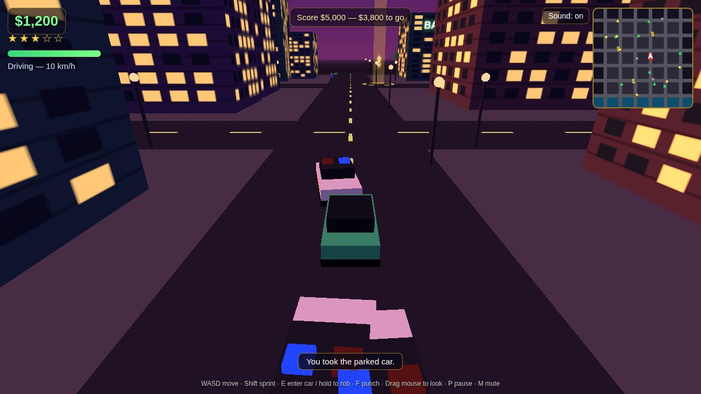

# NEON BAY — a pocket open-world crime game

[](https://make.fun/bounty/gta6-01?utm_source=github&utm_medium=readme&utm_campaign=gta6-01)
[](https://make.fun/bounty/gta6-01/leaderboard?utm_source=github&utm_medium=readme&utm_campaign=gta6-01)
[](https://make.fun/bounty/gta6-01?utm_source=github&utm_medium=readme&utm_campaign=gta6-01)
[](https://make.fun/bounty/gta6-01)
[](LICENSE)
[](https://threejs.org)

**NEON BAY** is a small open-world crime game you can play entirely offline in
a desktop browser. There is no installer, no build step and no network traffic:
the game is a handful of static files, three.js is vendored in, every texture
is painted on a canvas at runtime, and every sound is synthesised live with
WebAudio.

## Built for make.fun

This entry was made for the [make.fun gta6-01 bounty](https://make.fun/bounty/gta6-01)
($1,666, top 100 paid). Everything in it — the city, the
characters, the names, the art and the sound — is original work created for
this bounty.

## The job

You are Rex Marlowe, a wheelman who just rolled into Neon Bay, a sun-soaked
coastal city that never really sleeps. You need **$5,000** in your pocket
before the NBPD brings you down. Hit the three stores, scoop up the cash
bags lying around town, borrow a car or two, and keep the heat off your tail.




## How to run it

```sh
node serve.ts        # serves game/ on http://localhost:8080
```

Then open http://localhost:8080 in a desktop browser. ES modules need HTTP,
so opening the HTML file directly will not work — the little server above is
all you need. Nothing is downloaded at runtime: `game/index.html` loads the
vendored three.js r152 and the game's own modules, and that is the whole
dependency list.

| Key | Action |
| --- | --- |
| Enter | Start / restart after BUSTED, WASTED or win |
| WASD | Move on foot / drive (W accelerate, S brake/reverse, A/D steer) |
| Shift | Sprint on foot |
| E | Enter or exit a car (near one); hold E in a gold `$` ring to rob |
| F | Punch a nearby pedestrian |
| Mouse drag | Orbit the camera |
| P / Esc | Pause · M mute |

## What is in the game

- **The city** — a 5×5 grid of blocks between 6 roads each way, towers from
  8 to 40 m tall with glowing lit windows, neon signs (HOTEL, CASINO, 24/7,
  BAY BANK), street lamps, palm trees, and a beach with the ocean along the
  south edge. It is dusk: a purple-orange sky, warm fog and a low warm sun.
- **On foot** — a third-person character with a walk-cycle animation, sprint,
  and solid building collision.
- **Driving** — arcade handling with a chase camera and the speed in the HUD.
  Seven traffic cars cruise the lanes and turn at intersections; four cars
  sit parked. Press E near a traffic car to pull the driver out and take it
  (+1 wanted star).
- **Pedestrians** — twelve people walk the sidewalks, wander, and run when
  they are scared or a car gets too close. F punches one down (+1 star).
- **Wanted level, 0–5 stars** — a robbery adds 2, a carjack 1, a punch 1.
  One to four NBPD cars spawn and chase you, light bars flashing, siren
  wailing; they ram your car and run you down on foot. Stay clean and the
  heat cools one star every 20 seconds. If the police hold you on foot you
  are **BUSTED** — half your cash is gone and you wake up at the beach. At
  HP 0 you are **WASTED**.
- **The score** — three robbery targets, each marked by a floating `$` beacon
  and a minimap marker: Casa Oro Jewelers ($800–1,500), Bay Federal Bank
  ($1,000–1,500) and the 24/7 Mini-Mart ($500–900). Stand in the ring and
  hold E for 3 seconds. Eight green cash bags worth $100 each are scattered
  around the city. Reach $5,000 and you get the **SCORE COMPLETE** screen
  with your cash, robberies, bags, crimes and time. Your best cash is kept
  in localStorage.
- **HUD and minimap** — cash, wanted stars, health bar, speed, the current
  objective, a robbery progress bar, toasts, and a 180 px top-down minimap
  showing roads, the player, traffic, police, mission markers and cash bags.
- **Sound** — WebAudio synth only: an engine hum that rises with speed, a
  two-tone siren while you are wanted, a pickup blip, a robbery chime, a
  crash thud, and busted/win jingles.

## Repository layout

```
game/                  the playable game (static files only)
  index.html           loads vendor/three.min.js, then src/main.js
  vendor/three.min.js  three.js r152 UMD (vendored, 633 KB)
  src/                 main, city, cars, police, player, missions,
                       hud, minimap, sound, input, config, random, shots
screenshots/          4 staged shots (1280x720, ?shot=start|play|drive|chase)
main.ts                hands game/ + screenshots/ to make.fun (Node 22, stdlib only)
serve.ts               static server for local play (localhost:8080)
shots.json             the 4 screenshot scenes and their ?shot= queries
tools/                 shoot.mjs (screenshot + playtest harness),
                       function-test.mjs (11 scripted gameplay checks),
                       fps.mjs (headless FPS probe)
```

Verification: `tools/shoot.mjs` drives the game in headless Chromium
(SwiftShader WebGL) — all four `?shot=` scenes reach `window.__shotReady`
with 0 console errors, 0 page errors and 0 failed requests, and a live
playtest confirms Enter starts the game and WASD moves the player.
`tools/function-test.mjs` passes 11/11 scripted checks (robbery pays, police
spawn, carjack, driving, punch, cash bag, win at $5,000, BUSTED halves cash,
WASTED at HP 0). The full test report lives in `BUILD-LOG.md`.

## License

MIT — see [LICENSE](LICENSE). All names, characters, places, art and sound
are original works made for this entry.
