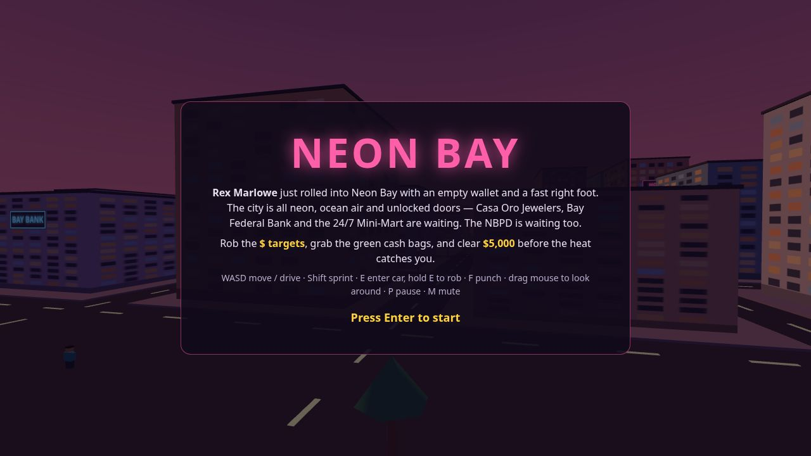
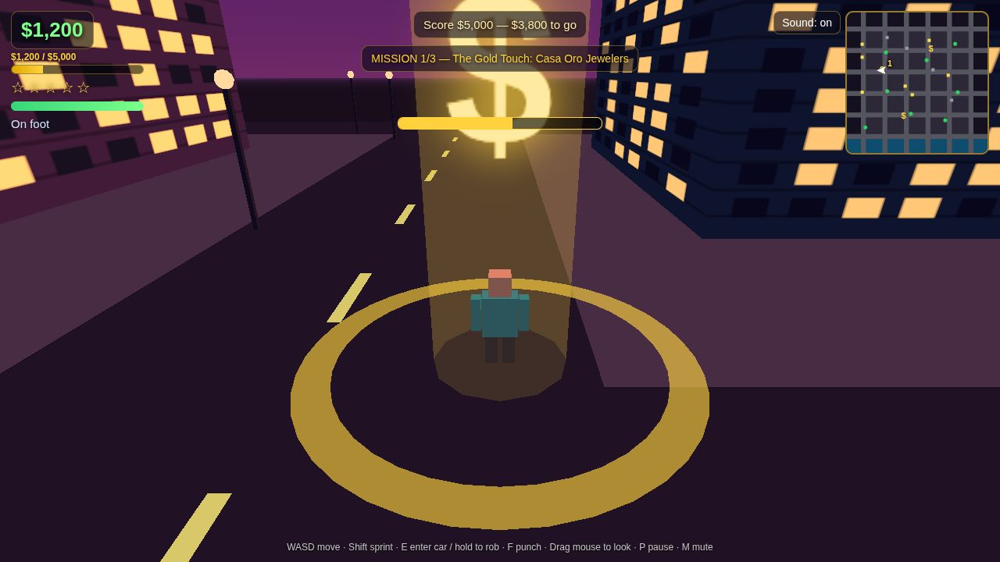
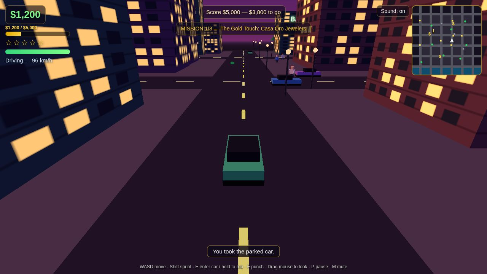

# NEON BAY — an open-world crime game

[](https://make.fun/bounty/gta6-01?utm_source=github&utm_medium=readme&utm_campaign=gta6-01)
[](https://make.fun/bounty/gta6-01/leaderboard?utm_source=github&utm_medium=readme&utm_campaign=gta6-01)
[](https://make.fun/bounty/gta6-01?utm_source=github&utm_medium=readme&utm_campaign=gta6-01)
[](https://make.fun/bounty/gta6-01)
[](LICENSE)
[](https://threejs.org)

**NEON BAY** is an original open-world crime game that runs offline in a desktop
browser from its own static files — no build step, no network, no external
assets. Built for the [make.fun gta6-01 bounty](https://make.fun/bounty/gta6-01)
("Make GTA 6", $1,666, top 100 paid).

Rex Marlowe, a wheelman new to the sun-soaked coastal city of Neon Bay, has to
clear **$5,000** before the NBPD catches him. Rob the three stores, grab the
cash bags, steal cars, and stay ahead of the heat.






## Play

```sh
node serve.ts        # serves game/ on http://localhost:8080
```

Open http://localhost:8080 in a desktop browser. No install, no network:
`game/index.html` loads vendored three.js r152 and its own ES modules only.
(All textures are generated on canvas at runtime; all sound is synthesised
with WebAudio — there are no audio or image files.)

| Key | Action |
| --- | --- |
| Enter | Start / restart after BUSTED, WASTED or win |
| WASD | Move on foot / drive (W accelerate, S brake/reverse, A/D steer) |
| Shift | Sprint on foot |
| E | Enter or exit a car (near one); hold E in a gold `$` ring to rob |
| F | Punch a nearby pedestrian |
| Mouse drag | Orbit the camera |
| P / Esc | Pause · M mute |

## Systems

- **City** — 5×5 blocks between 6 roads each way, buildings 8–40 m with
  emissive lit windows, neon signs (HOTEL, CASINO, 24/7, BAY BANK), street
  lamps, palm trees, beach and ocean along the south edge. Dusk look:
  purple-orange gradient sky, warm fog, low warm sun.
- **On foot** — third-person character, walk-cycle animation, sprint,
  building collision.
- **Driving** — arcade physics, chase camera, speed in the HUD. 7 traffic cars
  drive the road lanes and turn at intersections. 4 parked cars, and
  carjacking: E near a traffic car pulls the driver out (+1 wanted star).
- **Pedestrians** — 12 walk the sidewalks, wander, and flee when wanted or
  when a car comes close. F punches one down (+1 star).
- **Wanted (0–5 stars)** — robbery +2, carjack +1, punch +1. 1–4 NBPD cars
  spawn and chase (flashing light bars, two-tone siren); they ram your car
  and run you down on foot. Wanted decays one star per 20 s without a crime.
  Police touch on foot → **BUSTED** (lose half your cash, respawn). HP 0 →
  **WASTED**.
- **Missions** — 3 robbery targets with floating `$` beacons and minimap
  markers (Casa Oro Jewelers, Bay Federal Bank, 24/7 Mini-Mart; hold E for
  3 s). 8 green cash bags ($100 each) around the city. Reach $5,000 →
  **SCORE COMPLETE** with your stats. Best cash is saved in localStorage.
- **HUD + minimap** — cash, wanted stars, health bar, speed, objective line,
  robbery progress, toasts, and a 180 px top-down minimap (roads, player,
  traffic, police, mission markers, cash bags).
- **Sound** — WebAudio synth only: engine hum pitched by speed, siren while
  wanted, pickup blip, robbery chime, crash thud, busted/win jingles.

## Layout

```
game/                  the playable game (static files only)
  index.html           loads vendor/three.min.js, then src/main.js
  vendor/three.min.js  three.js r152 UMD (vendored, 633 KB)
  src/                 main, city, cars, police, player, missions,
                       hud, minimap, sound, input, config, random, shots
screenshots/          4 staged shots (1280x720, ?shot=start|play|drive|chase)
main.ts                hands game/ + screenshots/ to make.fun (Node 22, stdlib only)
serve.ts               static server for local play (localhost:8080)
shots.json             the 4 screenshot scenes and their ?shot= queries
tools/                 shoot.mjs (screenshot + playtest harness),
                       function-test.mjs (11 scripted gameplay checks),
                       fps.mjs (headless FPS probe)
```

`tools/shoot.mjs` runs the game in headless Chromium (SwiftShader WebGL):
all 4 `?shot=` scenes reach `window.__shotReady` with 0 console errors,
0 page errors and 0 failed requests, and a live playtest proves Enter starts
the game and WASD moves the player. `tools/function-test.mjs` passes 11/11
scripted checks (robbery pays, police spawn, carjack, driving, punch, cash
bag, win at $5,000, BUSTED cash halved, WASTED at HP 0). See `BUILD-LOG.md`
for the full test report.

## License

MIT — see [LICENSE](LICENSE). All names, characters, places, art and sound
are original works made for this entry.
